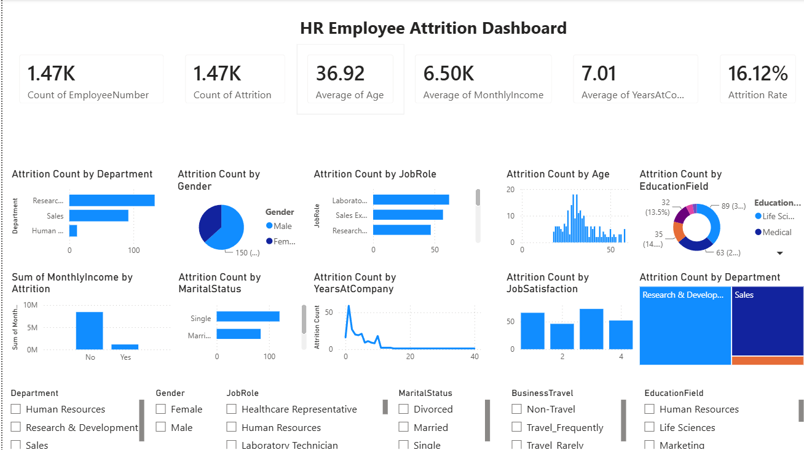

# HR Employee Attrition Analysis Dashboard

## Objective
Find the main reasons employees leave a company and suggest ways to reduce attrition.

## Dataset
1,470 employees from the IBM HR Analytics Employee Attrition dataset.

## Tools Used
SQL Server (SSMS), Python (Pandas, Kaggle Notebooks), Power BI (DAX)

## Approach
1. SQL: wrote queries to compare attrition across department, job role, overtime and tenure.
2. Python: cleaned the data and explored it with EDA.
3. Power BI: built a dashboard with Total Employees, Attrition Count and Attrition Rate measures, KPI cards and slicers.

## Key Findings
- Overall attrition rate: 16.1% (237 of 1,470 employees)
- Overtime workers: 30.5% attrition, vs 10.4% for those without overtime
- Sales Representatives: 39.8% attrition, the highest of any job role
- Employees with 2 years or less at the company: 29.8% attrition
- Single employees: 25.5% attrition, vs 12.5% for married
- Sales department: 20.6% attrition, vs 13.8% in Research & Development

## Dashboard

## Recommendations
- Review overtime workloads, since overtime is linked to much higher attrition.
- Add onboarding and support for new hires, especially in Sales.
- Look into pay and career growth for Sales Representatives.

## Files
- `HR Analytics.sql`: SQL queries (SSMS)
- `hr-attrition-analytics.ipynb`: Python EDA notebook
- `HR Attrition Analytics.pbix`: Power BI dashboard
- `WA_Fn-UseC_-HR-Employee-Attrition.csv`: dataset
